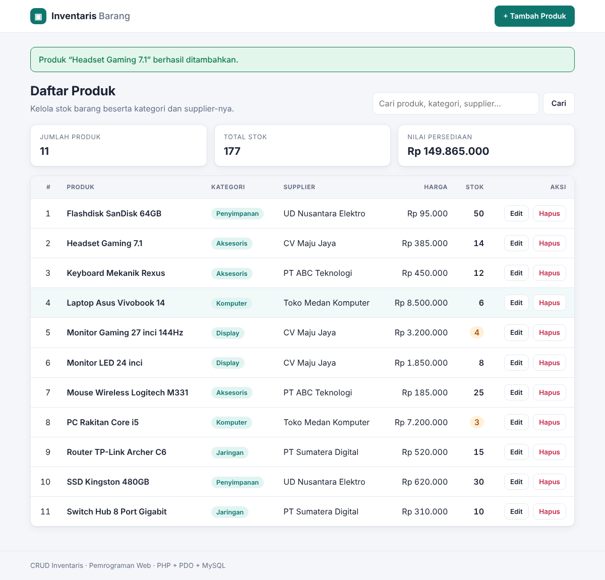
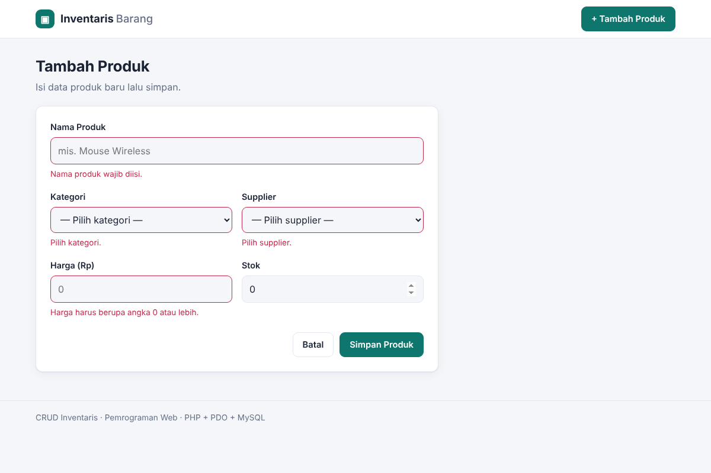
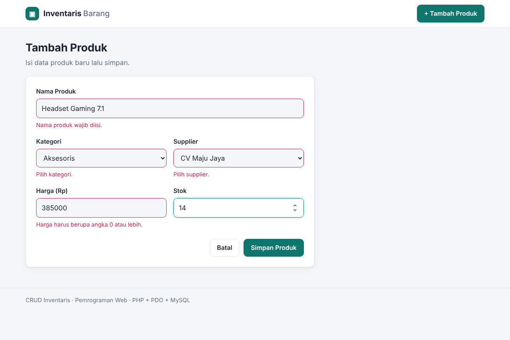
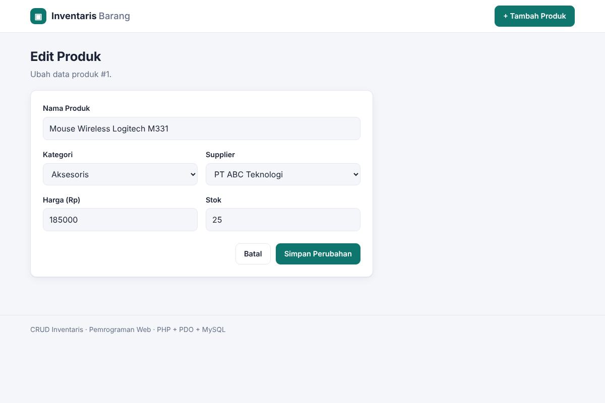

# CRUD Inventaris — Tugas Rutin 8

Aplikasi CRUD inventaris barang dengan **PHP native + PDO + MySQL**.
Mata kuliah **Pemrograman Web (3KOM40115)** · Pertemuan 8 · FMIPA UNIMED.

## Fitur

| Fitur | Keterangan |
|---|---|
| **Read** | Daftar produk dengan `JOIN` 3 tabel (products, categories, suppliers), ringkasan jumlah produk/total stok/nilai persediaan |
| **Create** | Form tambah produk dengan dropdown kategori & supplier |
| **Update** | Form edit yang sudah terisi (pre-filled) dengan data lama |
| **Delete** | Hapus lewat `POST` dengan dialog konfirmasi |
| **Cari** *(bonus)* | Cari berdasarkan nama produk, kategori, atau supplier |
| **Flash message** | Pesan sukses/gagal satu kali tampil (pola Post/Redirect/Get) |

## Keamanan

- Semua query yang melibatkan input pengguna memakai **prepared statements** (`prepare()` + `execute()`), tanpa concatenation string.
- PDO dikonfigurasi dengan `ERRMODE_EXCEPTION`, `FETCH_ASSOC`, dan `EMULATE_PREPARES = false` (real prepared statement).
- Semua output HTML di-escape dengan `htmlspecialchars()` (fungsi `e()`), mencegah XSS.
- Input divalidasi di sisi server (`filter_var`, cast tipe `int`/`float`); ID dari URL harus bilangan bulat positif.
- Token **CSRF** pada semua form POST (termasuk delete); delete tidak bisa lewat link `GET`.
- Detail error database hanya ditulis ke log (`error_log()`), pengguna hanya melihat pesan umum.
- Kredensial database dibaca dari `.env`, tidak ditulis di source code.

## Desain Database (3NF)

```
categories (id PK, name UNIQUE)
suppliers  (id PK, name, phone)
products   (id PK, name, category_id FK, supplier_id FK, price, stock)

categories 1 ──< N products N >── 1 suppliers
```

Data kategori dan supplier disimpan satu kali saja (tidak berulang di tiap baris produk), sehingga tidak ada redundansi dan tidak ada dependensi transitif.

## Struktur Proyek

```
crud-inventaris/
├── config/
│   └── database.php       # Singleton PDO
├── includes/
│   ├── helpers.php        # e(), flash, CSRF, validasi
│   ├── header.php
│   ├── footer.php
│   └── form.php           # form bersama create & edit
├── assets/style.css
├── schema.sql             # DDL + data seed (3 tabel)
├── index.php              # READ
├── create.php             # CREATE
├── edit.php               # UPDATE
├── delete.php             # DELETE
├── .env.example
└── screenshots/
```

## Cara Menjalankan

**Kebutuhan:** PHP 8.0+ dengan ekstensi `pdo_mysql`, serta MySQL/MariaDB (Laragon atau XAMPP sudah mencakup semuanya).

### 1. Import database

**Lewat phpMyAdmin**

1. Jalankan Apache + MySQL di Laragon/XAMPP.
2. Buka `http://localhost/phpmyadmin`.
3. Klik tab **Import** → **Choose File** → pilih `schema.sql` → **Import**.

**Lewat terminal**

```bash
mysql -u root -p < schema.sql
```

File ini membuat database `inventaris_db`, 3 tabel beserta foreign key, dan data seed (5 kategori, 5 supplier, 10 produk).

### 2. Atur koneksi

Default-nya `root` tanpa password (sesuai Laragon/XAMPP). Jika berbeda:

```bash
cp .env.example .env
# lalu edit DB_USER / DB_PASS sesuai server Anda
```

### 3. Jalankan aplikasi

Taruh folder proyek di `www/` (Laragon) atau `htdocs/` (XAMPP), lalu buka
`http://localhost/crud-inventaris/`.

Alternatif tanpa Apache:

```bash
php -S localhost:8000
# buka http://localhost:8000
```

## Screenshot

| Daftar produk (dengan flash message) | Validasi form |
|---|---|
|  |  |

| Form tambah | Form edit (pre-filled) |
|---|---|
|  |  |

Daftar produk awal (sebelum ditambah): `screenshots/01-daftar-produk.png`.

## Referensi

- Nixon, R. (2023). *Learning PHP, MySQL & JavaScript* (7th ed.). O'Reilly Media. Ch. 8–14.
- PHP PDO — https://www.php.net/manual/en/book.pdo.php
- MySQL Documentation — https://dev.mysql.com/doc
